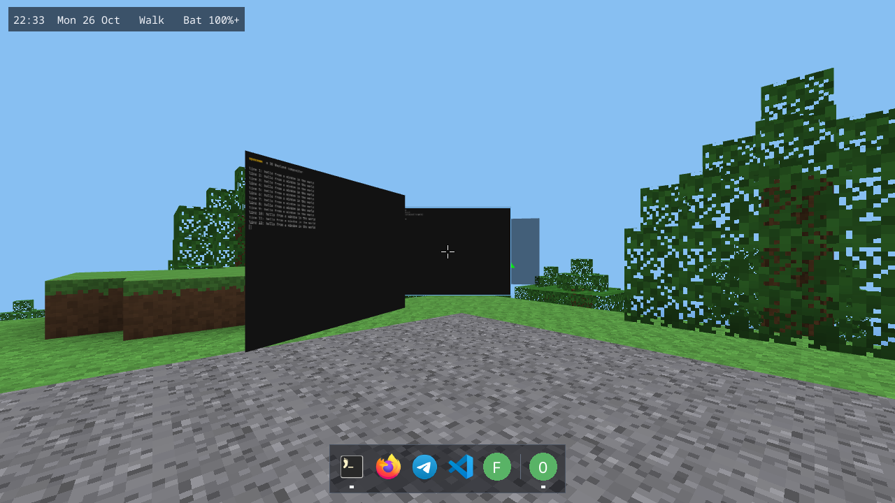
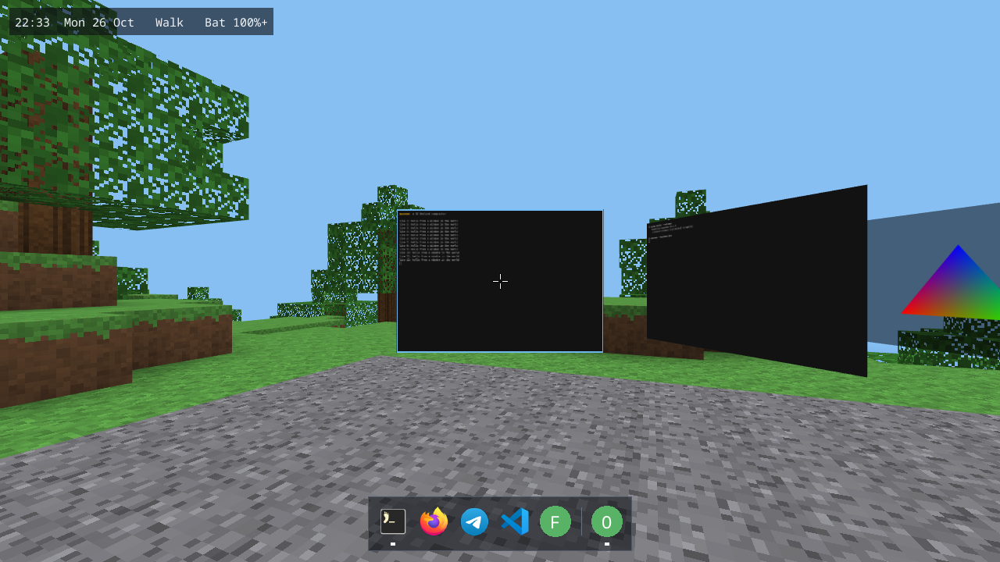
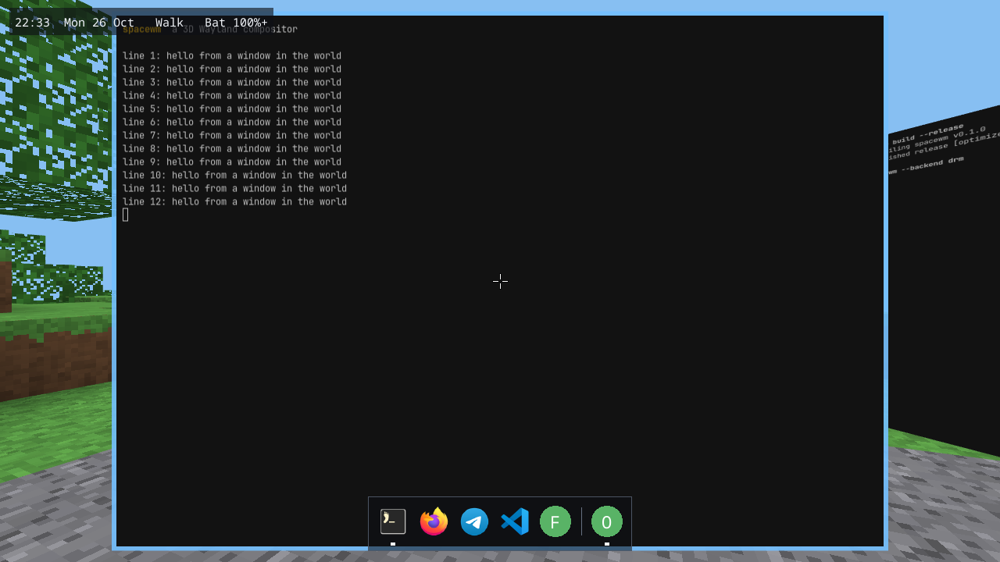
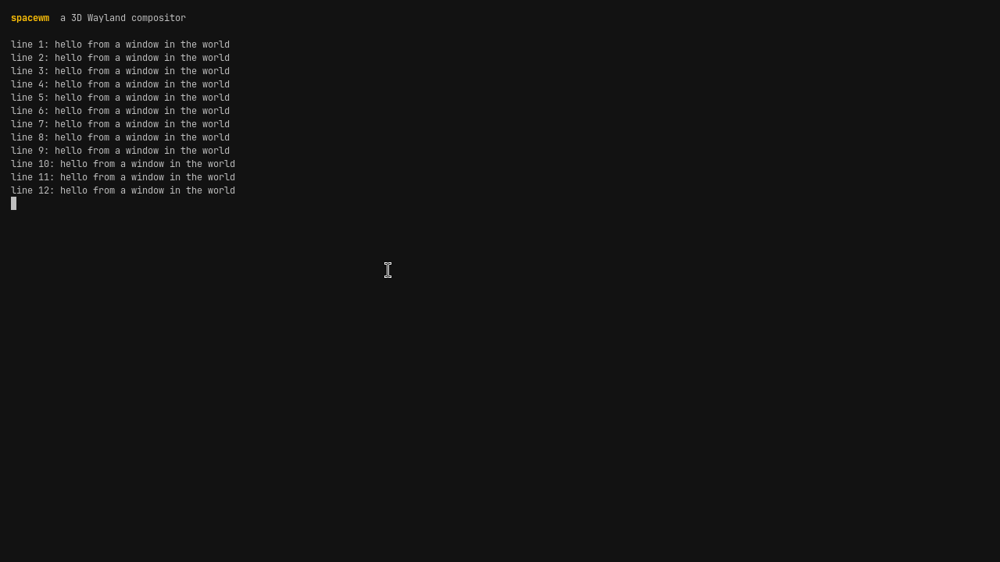
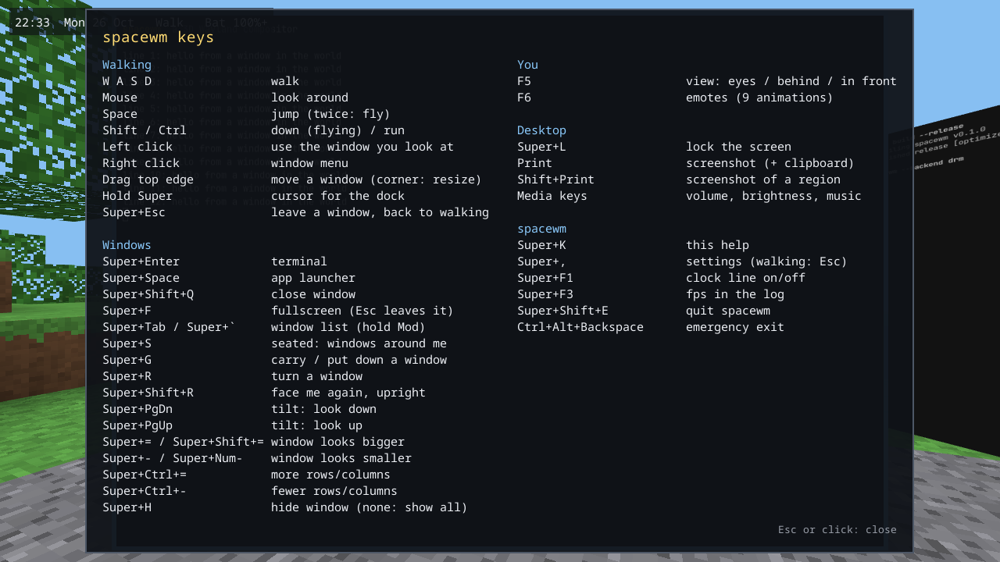
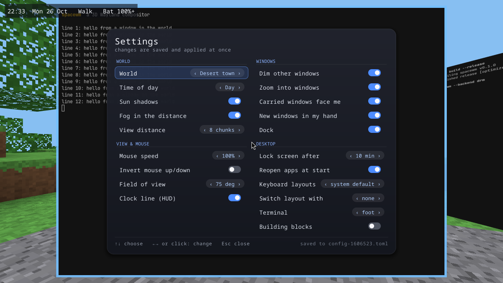
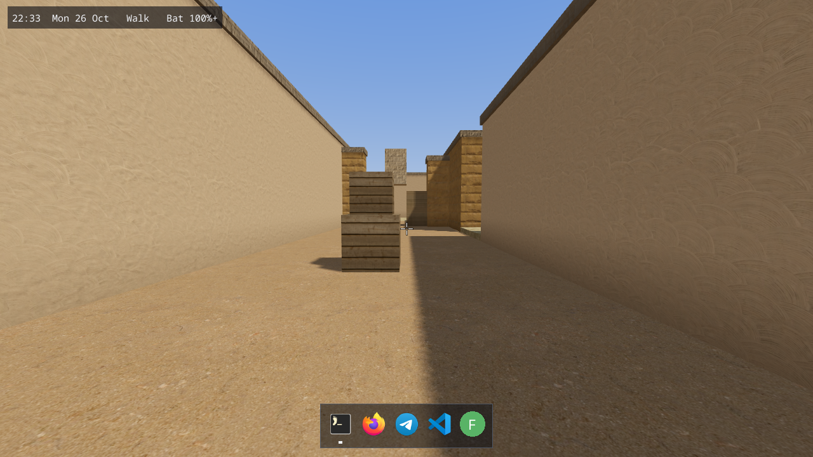

# spacewm

**A Wayland desktop where your windows are screens in a 3D world.**

spacewm is a window manager and compositor written from scratch in Rust. It is not based
on GNOME, KDE, Hyprland or any other existing desktop. Instead of tiling flat windows
side by side, every application window is a panel in a 3D world: you walk around it,
look at it, pick it up, turn it, put it on a wall, and type into it as if it were a real
screen in front of you.



---

## Contents

- [What it is, in plain words](#what-it-is-in-plain-words)
- [Screenshots](#screenshots)
- [Install (Arch, CachyOS and other Arch-based systems)](#install-arch-cachyos-and-other-arch-based-systems)
- [Your first five minutes](#your-first-five-minutes)
- [Controls](#controls)
- [How the world works](#how-the-world-works)
- [How it works inside (for people who want to understand the code)](#how-it-works-inside)
- [Configuration](#configuration)
- [Working with your normal apps](#working-with-your-normal-apps)
- [Controlling spacewm from outside (`spacectl`)](#controlling-spacewm-from-outside-spacectl)
- [Troubleshooting](#troubleshooting)
- [Building from source](#building-from-source)
- [Testing](#testing)
- [Repository layout](#repository-layout)
- [Status: what is tested and what is not](#status-what-is-tested-and-what-is-not)
- [Credits and licenses](#credits-and-licenses)

---

## What it is, in plain words

On a normal Linux desktop, a program called a **compositor** draws every window on your
screen and sends keyboard and mouse input to the right window. spacewm is that program.
It speaks the **Wayland** protocol, which is how modern graphical apps (terminals,
browsers, editors, chat apps) ask to be drawn. Any Wayland app works with it, and many
X11 apps work too through XWayland.

What makes spacewm different is what it does with those windows:

- Each window becomes a **panel** placed at a position in a **3D world** (metres from
  your character).
- You **walk** in that world with the keyboard and mouse. A window is only sharp and
  readable when you stand close to it, so looking at a window means walking up to it.
- Clicking a panel you look at **enters** it: the view glides in front of the window and
  your keyboard goes to that app. Leaving it glides you back.
- You can **carry** a window in your hand, put it down anywhere, **tilt** it, **resize**
  it, or arrange several windows around you (**seated mode**).
- The world is a desert town by default. A block world is also included.

It runs as a real session: you log in from a login screen (SDDM) and spacewm takes over
the screen, the same way Hyprland or GNOME does. It can also run as a window inside your
current desktop while you develop it.

spacewm is an experiment in making a desktop feel spatial. It is usable day to day, but
it is young: see [Status](#status-what-is-tested-and-what-is-not) before relying on it.

---

## Screenshots

| | |
|---|---|
|  **Walking up to a window.** The panel is a real app (terminal), drawn in the 3D world. |  **Close up.** Standing at the right distance, one window pixel is one screen pixel, so text stays sharp. |
|  **Window mode (Super+F).** The window fills the screen. Esc leaves it. |  **Every key, on screen.** Super+K shows the full list of controls. |
|  **Settings (Esc while walking).** Change the world, time of day, shadows, mouse speed and more, live. |  **The desert town.** The default world. Sun shadows are drawn once, so they cost almost nothing. |

---

## Install (Arch, CachyOS and other Arch-based systems)

The installer is `install.sh`. It is written for Arch-based systems (Arch, CachyOS,
EndeavourOS, Manjaro...). It uses `pacman` only: no AUR helper (`yay`, `paru`) is needed.

```sh
git clone https://github.com/voidsecurity404/spacewm.git
cd spacewm
./install.sh
```

Run it **as your normal user, never with sudo**. The script asks for your password itself
when it needs root, and only for these steps:

1. `sudo pacman -Syu` with everything spacewm needs (see the list below).
2. Building spacewm with `cargo`, as your user (not root).
3. Copying the binaries and the login-session files into the system.
4. `sudo systemctl enable sddm`: SDDM becomes the login screen at the next boot.
   It is enabled but not started, so your current screen is not taken over.

Useful options:

```sh
./install.sh --dry-run          # print every command it would run, change nothing
./install.sh --no-test-tools    # only spacewm and what it needs (no foot, weston, waybar, ...)
```

The script refuses to run if another login manager (GDM, LightDM, greetd, ly) is enabled,
because two login managers would fight over the screen at boot. Disable it first:
`sudo systemctl disable gdm.service` (or the one you use).

### What gets installed

| Group | Packages | Why |
|---|---|---|
| Build | `rust`, `base-devel`, `git`, `pkgconf` | compile spacewm; `git` fetches smithay from GitHub |
| System libraries | `seatd`, `systemd`, `libinput`, `mesa`, `libxkbcommon`, `wayland`, `libdrm` | the native libraries spacewm links to (input, GPU, keyboard, session) |
| X11 apps | `xorg-xwayland` | run X11 programs inside spacewm |
| Portals | `xdg-desktop-portal`, `-gtk`, `-wlr` | file pickers, screenshots and screen sharing for apps |
| Login screen | `sddm` | the screen where you choose the session |
| Screenshots | `grim`, `slurp` | Print and Shift+Print |
| Lock screen | `swaylock` | Super+L, and automatic lock after 10 minutes idle |
| Sound and brightness | `wireplumber`, `pipewire`, `brightnessctl` | volume, microphone and brightness keys |
| Test tools (optional) | `foot`, `weston`, `waybar`, `mako`, `fuzzel`, `libnotify`, `xterm` | the terminal used by the dock, and the programs the test suite uses |

### What it does not touch

- **GRUB is not changed.** spacewm needs nothing from the bootloader. SDDM is the login
  screen; GRUB only boots the system as before.
- **No autologin.** You pick "spacewm" in the SDDM menu at each login.
- **Your settings are not overwritten.** The configuration file is created on the first
  start, and only if it does not exist yet.

### Running it in a virtual machine

spacewm draws straight to the screen (the DRM/KMS backend), so the VM needs 3D graphics.
Use the VirtualBox settings below (VM powered off), then run `install.sh` inside the VM:

- **Settings > Display:** Graphics Controller **VMSVGA**, Video Memory **128 MB**,
  **Enable 3D Acceleration** on.
- **Super is taken by the host** (the Windows key goes to your real desktop). Inside the VM,
  spacewm therefore uses **Alt** as the Mod key.

When `install.sh` detects VirtualBox, it does three things more: installs the VirtualBox
guest tools (mouse, resize, clipboard), writes a new config with `mod_key = "alt"`,
`direct_panels = false` and `panel_mipmaps = false` (an existing config is never changed),
and prints this checklist again. Set `direct_panels` and `panel_mipmaps` back to `true` once
the picture is stable.

If the picture is wrong: **Ctrl+Alt+F3** opens a terminal, and
`tail -60 ~/.local/state/spacewm/spacewm.log` shows why. **Ctrl+Alt+Backspace** always leaves
spacewm.

### Uninstall

`just uninstall` prints the commands (it never runs them):

```sh
sudo rm /usr/local/bin/spacewm /usr/local/bin/spacectl /usr/local/bin/spacewm-session
sudo rm /usr/share/wayland-sessions/spacewm.desktop /usr/share/xdg-desktop-portal/spacewm-portals.conf
```

Your configuration stays in `~/.config/spacewm/` and your saved layout in
`~/.local/state/spacewm/`. Delete those folders too if you want a clean removal.

---

## Your first five minutes

**Keep a second TTY (Ctrl+Alt+F3) or an SSH session open the first few times you run
spacewm as a session.** It is the safe way out if something goes wrong.

1. At the SDDM screen, choose **spacewm** and log in. A 3D world appears: the character
   stands on the ground, and the clock, date, battery and keyboard layout are in the top
   left corner.
2. Press **Super+Return** (the Super key is the Windows key). A terminal opens in your
   hand. Press **left click** to put it down in front of you.
3. Press **left click** on the terminal to walk into it. Type `ls`, press Enter.
4. Press **Super+Escape** to leave it and walk again. Walk with **W A S D**, look with the
   **mouse**, jump with **Space**.
5. Press **Super+K** at any time to see every key on screen. **Esc** closes it.
6. Press **Super+Shift+E** to quit spacewm. If the screen ever freezes, press
   **Ctrl+Alt+Backspace**: it always exits.

---

## Controls

Mod is **Super** (the Windows key) in a real session. When spacewm runs nested inside
another desktop, Mod is **Alt** instead (so it does not clash with the host desktop).

The complete list below is also available in the game by pressing **Super+K**.

**Walking**

| Keys | Does |
|---|---|
| W A S D | walk |
| Mouse | look around |
| Space | jump (press twice quickly to fly) |
| Shift / Ctrl | down (when flying) / run |
| Left click | use the window you look at (enter it) |
| Right click | window menu (every entry shows its key) |
| Drag a window's top edge | move the window |
| Drag a window's corner | resize the window |
| Hold Super | a cursor for the dock |
| Super+Escape | leave a window, back to walking (always works) |

**Windows**

| Keys | Does |
|---|---|
| Super+Enter | new terminal |
| Super+Space | app launcher |
| Super+F | fullscreen (Esc leaves it) |
| Super+Tab / Super+` | window list (hold Super, press again to cycle; let go to go there) |
| Super+G | carry a window in your hand / put it down |
| Super+R | turn a window |
| Super+Shift+R | face me again, upright |
| Super+PgUp / Super+PgDn | tilt the window up / down |
| Super+= / Super+- | make the window look bigger / smaller |
| Super+Ctrl+= / Super+Ctrl+- | more / fewer rows and columns in a terminal |
| Super+Shift+Q | close the window |
| Super+H | hide a window (no hidden window: show all) |
| Super+S | seated mode: all windows arranged on an arc around you |

**You and the desktop**

| Keys | Does |
|---|---|
| F5 | view: eyes / behind / in front |
| F6 | emote menu (9 animations) |
| Esc (walking) | settings |
| Super+, | settings (saved to the config file, comments kept) |
| Super+L | lock the screen |
| Super+F1 | clock line on / off |
| Super+F3 | frames per second in the log |
| Super+K | this help |
| Super+Shift+E | quit spacewm |
| Ctrl+Alt+Backspace | emergency exit (always works) |
| Print | screenshot of the whole screen (also copied to the clipboard) |
| Shift+Print | screenshot of a region you drag |
| Volume, mute, microphone, brightness, play/pause keys | with an on-screen level |

Keys can be changed in the `[keybinds]` section of the configuration file. Each action
takes one combo or a list of combos (`""` unbinds it).

---

## How the world works

**Panels and distance.** Each window is a flat panel with a size in metres and a position
in the world. A panel is sharp only when you stand at the distance where one window pixel
is one screen pixel. spacewm places new panels at that distance (`spawn_distance = "auto"`)
so text is readable. Farther away, the panel is drawn smaller and softer, the same way a
real screen looks from across the room.

**New windows** come into your hand, a little away from you (`carry_new_windows = true`).
Look where you want it, click to put it down. The mouse wheel moves it nearer or farther.

**Carrying and tilting.** A window you carry leans to face you: put it up high and it looks
down at you, low and it looks up. You can also tilt any window by hand.

**Focus zoom.** Entering a window glides the camera in front of it, so you read it at the
right distance without thinking about it. Leaving glides you back to where you stood.

**Window mode** (Super+F, or click a panel and press Super+F) fills the screen with one
window. Other panels are dimmed (`dim_unfocused`). Esc returns you to the world.

**Seated mode** (Super+S) puts all the windows on an arc around you. Useful when you do not
want to walk: you turn your head and the windows you look at are in front of you.

**The dock** runs along the bottom while you walk. Hold Super to show the cursor: left click
brings an open app's window to you (again: the next window of that app) or starts it; right
click starts a new one. Favourite apps are set in `[dock] apps`.

**Worlds.** Two worlds ship with spacewm:

- `dust`: a desert town (the default). Sun shadows, sand, crates, walls. See
  `resources/maps/dust/`.
- `voxel`: a block world with terrain and trees. With `general.building = true`, you can
  place and break blocks with the mouse and the hotbar (keys 1-5, inventory with E).

Switch between them in Settings (Esc) or with `world.map` / `--map`.

**Settings** (Esc while walking) change the world, time of day, sun shadows, fog, view
distance, mouse speed, field of view, the HUD, and window behaviour. They are saved to the
config file as you change them.

---

## How it works inside

This section explains the moving parts for people who want to understand (or change) the
code. Terms are explained the first time they appear.

### Wayland, in one paragraph

Wayland is the protocol between an application and the compositor. An app draws its
contents into a **buffer** (a block of pixels, or a GPU buffer called a **dmabuf**) and
tells the compositor "this surface now shows that buffer". The compositor owns the
screen. It decides where every surface goes, delivers keyboard and mouse events to the
right app, and draws the final picture. spacewm implements the compositor side of this
protocol, so apps do not know they are inside a 3D world.

### Built on smithay

spacewm uses **smithay**, a Rust library that implements the Wayland server side and the
hardware plumbing (GPU, input, sessions). spacewm takes smithay's pieces and adds its own
3D renderer and world. smithay is taken from its git `main` branch because its released
versions lag behind.

### Backends: where the picture goes

| Backend | What it is | Used for |
|---|---|---|
| `winit` | a window inside your current desktop | development (`--backend winit`) |
| `drm` | directly on the screen through **DRM/KMS** (the kernel's display interface), with **libinput** for keyboard and mouse and **libseat** to get the devices without being root | a real session (SDDM, or from a TTY) |
| `headless` | no screen; renders offscreen on the GPU | automated tests and screenshots |

**libseat** is how a program that is not root is allowed to open the GPU and input
devices: the session manager (systemd-logind here) hands them over. That is why spacewm
must never be started with `sudo`.

### Rendering a frame

1. Every visible window is turned into a **panel texture**: the app's buffer is copied
   (or, when the window is close and simple, used directly with no copy: `direct_panels`)
   into a texture on the GPU. The texture keeps **mipmaps** (smaller copies, used when the
   panel is far away) so distant text does not shimmer.
2. The **scene** draws the world (terrain, buildings, trees, the character, the sky) and
   then each panel as a textured quad at its place in 3D. A custom GLSL shader
   (`src/render/shaders/panel.frag`) draws the panel's texture with its border, its dark back
   side, the world's fog, and the opacity used when a panel is dimmed.
3. Work is spent only where it is seen. Panels you look away from are not redrawn. Panels
   far away update at `far_panel_fps` (default 15). The dock's icon list is cached and
   rebuilt only when windows, favourites or installed apps change.
4. The frame goes to the screen (DRM), to a window (winit), or to memory (headless, for
   tests).

### Input

Keyboard and mouse events come from libinput (or from the window system in winit). spacewm
decides what they mean depending on the **mode**:

- **Walking**: keys move the character, the mouse turns the camera, a click asks "what
  panel is under the crosshair?" (a **raycast**: a line from the eye through the centre of
  the screen, tested against the panels).
- **Window**: keys and the mouse go to the focused app; Mod keys stay with spacewm.
- **Seated** and **Launcher**: their own input rules.

### Apps, focus, and the Wayland protocols spacewm speaks

spacewm implements the protocols a modern desktop needs:

- `xdg-shell`: normal windows, popups and menus;
- `wlr-layer-shell`: panels such as waybar, notifications such as mako, the launcher such as
  fuzzel;
- `ext-session-lock`: the lock screen (swaylock);
- `ext-idle-notify`: knowing when you are idle;
- `wlr-screencopy`: screenshots and screen sharing (grim, portals);
- `linux-dmabuf`: GPU buffers from apps (no copy through the CPU);
- `fractional-scale`, `xdg-decoration`, `xdg-activation`, data device and primary selection
  (copy and paste, drag and drop);
- XWayland, for X11 apps.

### Desktop integration

spacewm is a desktop, so it also handles the things a desktop handles:

- **Gate and isolation.** Apps you start from a terminal inside spacewm (`firefox`, `code`)
  go through spacewm first, so spacewm can notice that the same app is already running on
  your other desktop. Details: `src/spawn.rs`, `src/isolate.rs`, `src/desktop/elsewhere.rs`.
- **Session restore.** The apps open when spacewm exits are reopened at the next start
  (`restore_apps`). Details: `src/desktop/restore.rs`.
- **Locking.** Super+L and automatic lock after idle run `swaylock` (configurable).
- **Status.** The HUD shows the time, date, battery and keyboard layout
  (`src/desktop/status.rs`).
- **Portals.** `xdg-desktop-portal` gets `XDG_CURRENT_DESKTOP=spacewm` and uses GTK for file
  pickers and WLR for screenshots (`resources/spacewm-portals.conf`).

### Source map

| Area | Where | What |
|---|---|---|
| Entry point | `src/main.rs`, `src/cli.rs` | command line, logging, starting the backend and the event loop |
| Backends | `src/backend/` | winit, DRM, headless |
| Wayland protocols | `src/wayland/` | one file per protocol |
| World | `src/world/` | panels, the player, maps, voxels, block edits, layout |
| Rendering | `src/render/` | scene, camera, panel textures, shaders, HUD, dock, menus |
| Input and modes | `src/input/` | walking, window, seated, carrying, raycasts |
| Desktop features | `src/desktop/`, `src/isolate.rs`, `src/spawn.rs`, `src/launcher/` | apps, restore, locking, status, launcher |
| Config | `src/config/` | reading, live reload, applying, editing the file |
| Control socket | `src/ipc/`, `src/bin/spacectl.rs` | JSON commands to a running spacewm |
| XWayland | `src/xwayland/` | X11 apps |

---

## Configuration

The configuration file is `~/.config/spacewm/config.toml`. It is created on the first start
with **every option and its default value**, and every option has a comment explaining it.
Delete a line to get its default back.

- **Live reload.** Saved changes apply within a second, no restart needed. A mistake keeps
  the previous settings and shows the error on screen.
- **Check it:** `spacewm --check-config` (exit code 0 if valid, 1 if not).
- **Settings menu.** Most options are also in the settings screen (Esc while walking), and
  changes made there are written back to the file with the comments kept.

The main sections:

| Section | Controls |
|---|---|
| `[general]` | the Mod key, the terminal, autostart programs, world seed, block building, shell commands for `spacectl spawn` |
| `[input]` | mouse speed and inversion, walk and sprint speed, keyboard layout, switching layouts |
| `[render]` | field of view, view distance, fog, mipmaps, idle frame cap, `far_panel_fps`, `direct_panels`, HUD, vsync |
| `[world]` | the world (`dust` or `voxel`), sun shadows, time of day |
| `[panels]` | pixels per metre for new windows, spawn distance, dimming, focus zoom, auto tilt, carry new windows |
| `[dock]` | whether the dock shows, and the favourite apps |
| `[desktop]` | locking command and idle time, reopening apps at start, running-elsewhere behaviour, screenshot folder and region tool, media-key commands |
| `[keybinds]` | every key binding, as a combo or a list of combos |

A few examples:

```toml
[render]
fov = 75.0                 # vertical field of view, degrees
far_panel_fps = 15         # apps on distant panels redraw at most this often (0: no cap)

[world]
map = "voxel"              # "dust" (desert town) or "voxel" (block world)

[desktop]
lock_after_minutes = 0     # 0: never lock on idle
running_elsewhere = "move" # "ask" | "move" | "leave"

[keybinds]
spawn_terminal = ["Mod+Return", "Mod+Shift+Return"]   # more than one combo for one action
next_window = "Mod+Tab"                              # "" unbinds the action
```

### Two performance options worth knowing

- `render.far_panel_fps` (default 15): apps on panels more than 10 metres away draw at this
  rate. Their text is tiny from there, so the difference is invisible, and a busy terminal
  across the room costs far less CPU (about 14% down to about 5% in our measurement).
- `render.direct_panels` (default on): the window you are close to is drawn straight from
  the app's own texture, with no copy. Windows with open menus, video layers or unusual
  buffers fall back to the copy automatically.

---

## Working with your normal apps

- **Apps that are already open on your other desktop.** Many apps run only once: starting
  them again just asks the copy that is running to show a window. If you start such an app
  inside spacewm, spacewm notices and asks what to do (`running_elsewhere`): close it there
  and open it here (**ask**, the default), do that without asking (**move**), or leave it
  where it is (**leave**). Closing it asks the app to quit, the same way closing its window
  does, and it opens here with your usual profile, so logins and tabs stay.
- **Session restore.** Apps open when you quit come back at the next start, where their
  windows were (`restore_apps`).
- **X11 apps** run through XWayland. Use `--no-xwayland` to turn that off.
- **Flatpak apps** are recognised too: `flatpak run ...` checks for the same app running
  outside spacewm first.
- **Screenshots.** Print saves the whole screen to `~/Pictures/Screenshots` and copies it to
  the clipboard. Shift+Print lets you drag a region (uses `slurp`).

---

## Controlling spacewm from outside (`spacectl`)

`spacectl` talks to the running spacewm over a JSON socket. The socket is created at
`$XDG_RUNTIME_DIR/spacewm-$WAYLAND_DISPLAY.sock` with mode `0600`, and spacewm checks the
peer's user id (SO_PEERCRED): only your own user can connect, even if file permissions
were changed. Requests are capped at 64 KiB. Full protocol: [`docs/ipc.md`](docs/ipc.md).

```sh
spacectl version                    # spacewm version and backend
spacectl list                       # all windows (panels) with their ids and positions
spacectl move 3 0 2 -4              # move panel 3 to x=0, y=2, z=-4 (metres)
spacectl focus 3                    # focus panel 3
spacectl mode window 3              # look at panel 3 in window mode
spacectl spawn foot -e htop         # start a program inside spacewm
spacectl screenshot shot.png        # save a PNG of the screen (inside your home folder)
spacectl stats                      # frames per second, frame times, GPU memory
spacectl watch                      # print events as they happen
spacectl reload-config              # re-read the config file now
```

Synthetic keyboard and mouse input (`spacectl input ...`) is **off by default**: any program
of your user could otherwise type into your terminals. It is enabled only when spacewm is
started with `--allow-input-injection`, which the automated tests use.

Profiling: `cargo run --features profile` sends frame spans to **tracy**;
`SPACEWM_SPAN_TIMES=1 RUST_LOG=spacewm=trace` logs how long each frame phase takes.
`tests/perf/bench.sh` measures idle and busy CPU use.

---

## Troubleshooting

**The screen is black after choosing spacewm in SDDM.** Switch to another terminal
(Ctrl+Alt+F3), log in, and read the log:

```sh
tail -n 80 ~/.local/state/spacewm/spacewm.log
```

Check that the GPU is visible to spacewm: `spacewm --drm-probe` lists GPUs, monitors and
modes, and changes nothing. In a virtual machine, check the 3D acceleration and the
VMSVGA and 3D settings (see [Running it in a virtual machine](#running-it-in-a-virtual-machine)).

**I cannot get back to my session.** Press **Ctrl+Alt+Backspace** (always exits spacewm),
or **Ctrl+Alt+F3** for another terminal, then `systemctl restart sddm` if needed.

**Keys do not respond, or the wrong keys work.** Check the keyboard layout in
`[input]` (`keyboard_layout`), or unset it to use the system layout.

**A settings change did not apply.** Run `spacewm --check-config`. A syntax error keeps the
previous settings, and the error is shown on screen and in the log.

**A program opened on the other desktop instead of inside spacewm.** That is the
running-elsewhere feature (see [Working with your normal apps](#working-with-your-normal-apps)).
Set `running_elsewhere = "leave"` to disable it.

**Where are the logs?** Standard error, and `~/.local/state/spacewm/spacewm.log` (the previous
run is kept as `spacewm.log.old`).

**Reporting a problem.** Include the output of `spacewm --version`, your GPU (`lspci -k | grep -A3 VGA`),
the relevant part of `spacewm.log`, and the steps to reproduce.

---

## Building from source

You need a Rust toolchain (`rust` on Arch), `git` (smithay is fetched from GitHub on the
first build), and the development packages listed in the [install section](#what-gets-installed).

```sh
cargo build --release
cargo run -- --backend winit               # nested window inside your current desktop
cargo run -- --backend winit --spawn foot  # ... and start a terminal
```

Useful when developing:

```sh
just check      # formatting, clippy with warnings as errors, unit tests
just e2e        # end-to-end tests (needs a GPU render node)
just run        # cargo run with arguments
```

---

## Testing

- **Unit tests** (`cargo test`): the logic of the world, the input modes, the config,
  the IPC protocol, the launcher, and more.
- **End-to-end tests** (`tests/e2e/*.sh`): each script starts spacewm headless
  (`--backend headless --allow-input-injection`), drives real Wayland apps with `spacectl`,
  and checks the result: pixel comparisons of screenshots, the window list, log messages,
  the frame rate, memory and file descriptors over long runs. Screenshots are saved to
  `~/spacewm-test/` for visual checks.
- **Soak test** (`stage15_soak.sh`, `SOAK_CYCLES=240`): repeats the newer features over and
  over and checks that memory levels off and no file descriptors leak.
- **DRM tests** (`tests/drm/`, see its README): run spacewm on a real display through
  systemd. They need root for `systemd-run` and are not part of `just e2e`.

---

## Repository layout

```
src/           the compositor (see the source map above)
resources/     config template, session files, portal config, fonts, maps, the knight model
docs/          ipc.md (control socket), tushuntirishlar.md (detailed notes in Uzbek),
               screenshots/
tests/e2e/     end-to-end scripts and helpers
tests/drm/     real-display tests
tests/perf/    CPU benchmark
examples/      small standalone examples
install.sh     installer for Arch-based systems
justfile       check, e2e, run, install (prints commands only)
```

Design notes, with the reasoning behind each feature, are in
[`docs/tushuntirishlar.md`](docs/tushuntirishlar.md) (in Uzbek).

---

## Status: what is tested and what is not

spacewm works, and it is tested, but it is not yet proven on a wide range of hardware.
Honest status:

**Tested**
- Unit tests and clippy pass; the end-to-end suite passes on the release and debug builds.
- A 240-cycle soak test on the release build: no leaked file descriptors, memory levels off.
- Real apps drawn in the 3D world, close up, with the direct-texture path: VS Code,
  Telegram, `weston-simple-egl` (GPU/dmabuf). Firefox draws correctly through the copy
  path (it has extra surfaces, so spacewm uses the safe path automatically).
- The nested (winit) session ran for about 9 minutes without warnings or errors.

**Not yet tested**
- The real DRM session on many machines (only on the author's hardware). The DRM test
  scripts are in `tests/drm/`.
- The direct-texture path with more GPU apps. Its pixel test covers shared-memory apps
  (foot); GPU buffers are checked by eye.
- Sessions that run for days, and multi-monitor setups.

If you run it and something goes wrong, the log file is the first place to look, and an
issue with the log and the steps to reproduce is the most useful report.

---

## Credits and licenses

spacewm's own source code is written by its author. **The project licence has not been
chosen yet**; until one is added, all rights are reserved by the author.

Bundled assets, with their own licences:

- **Knight character** (`resources/characters/knight.glb`): from *KayKit: Adventurers
  Character Pack* by Kay Lousberg, **CC0** (public domain). See
  [`resources/characters/LICENSE.md`](resources/characters/LICENSE.md).
- **Desert town textures** (`resources/maps/dust/`): from Poly Haven, **CC0**. The map layout
  is original. See [`resources/maps/dust/LICENSE.md`](resources/maps/dust/LICENSE.md).
- **Noto Sans Mono** (`resources/fonts/`): **SIL Open Font License**. See
  `resources/fonts/NotoSansMono-OFL.txt`.

Built on the work of: [smithay](https://github.com/Smithay/smithay) (Wayland and hardware
plumbing), the Wayland protocols, OpenGL ES through `glow`, `glam`, `tracing`, `clap`,
`toml`, and the other Rust crates listed in `Cargo.toml`.
